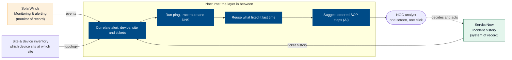
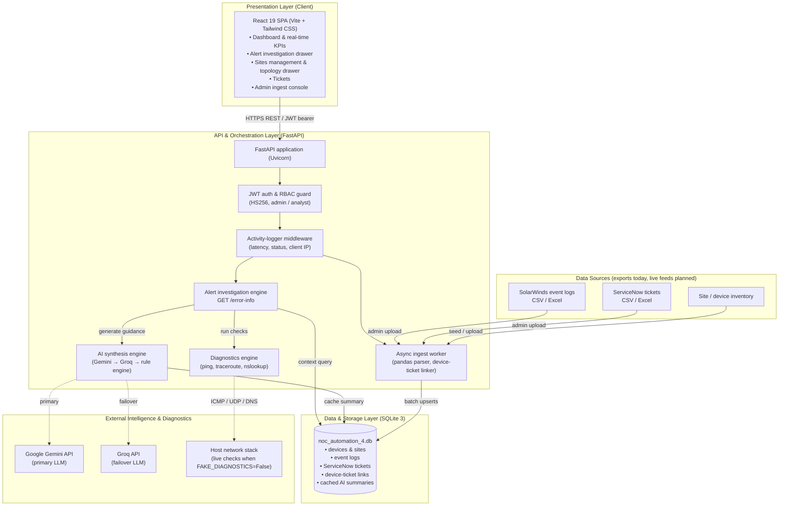
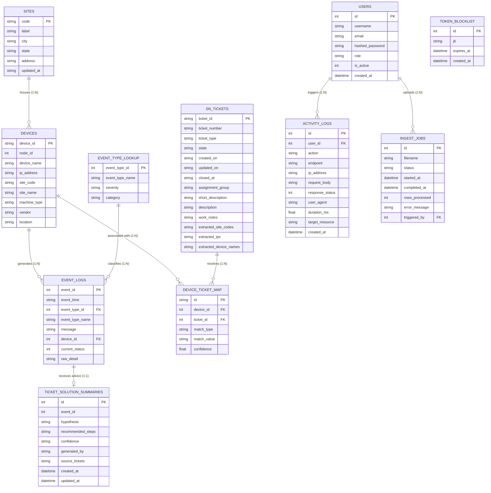
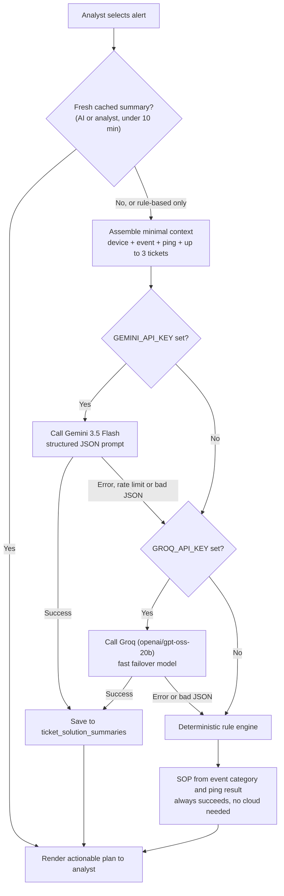
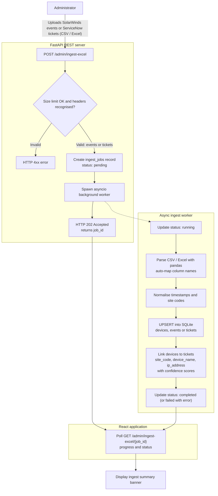
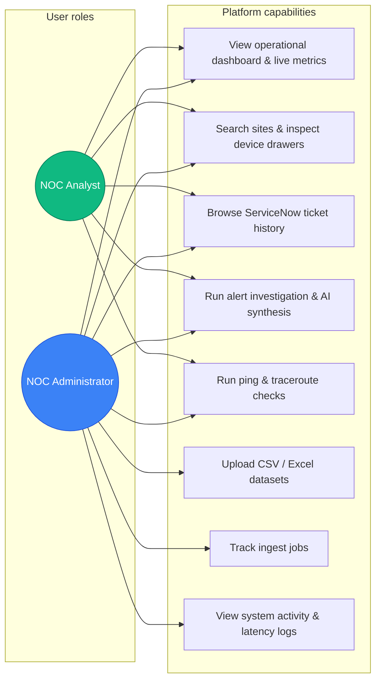
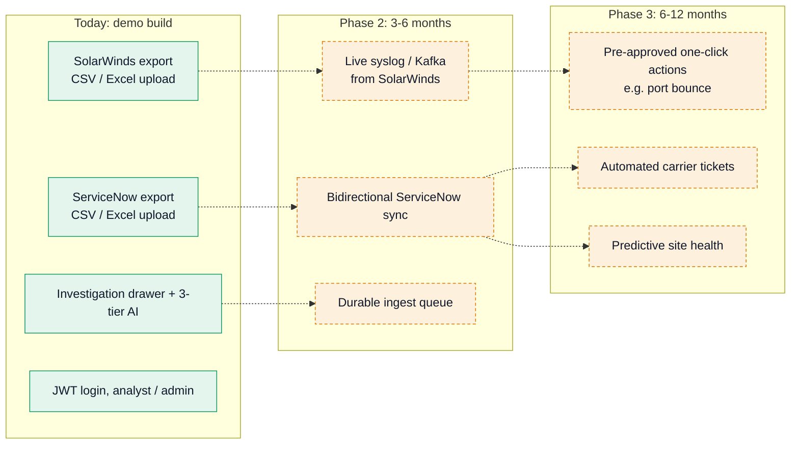

# Nocturne — Technical Diagrams & Systems Architecture

This document holds the architectural and workflow diagrams for **Nocturne** (formerly NAAP), the NOC alert-investigation platform that connects SolarWinds events, ServiceNow history and live diagnostics. All diagrams use Mermaid and were checked against the codebase (routers, services, migrations and `config.py`).

| # | Diagram | Answers |
|---|---|---|
| 1 | Where Nocturne fits | How does it relate to SolarWinds and ServiceNow? |
| 2 | System context & layered architecture | What are the components and boundaries? |
| 3 | End-to-end alert investigation sequence | What happens when an analyst opens an alert? |
| 4 | Entity-relationship diagram | How is the data modelled? |
| 5 | Multi-tier AI synthesis | What if Gemini or Groq is down? |
| 6 | Asynchronous ingestion pipeline | How do exports get in? |
| 7 | RBAC & use cases | Who can do what? |
| 8 | Roadmap: demo to live integrations | What is real today vs. planned? |

---

## 1. Where Nocturne Fits
Nocturne is the layer between the monitor (SolarWinds) and the ticket system (ServiceNow). It replaces neither.

---

## 2. System Context & Layered Architecture
How data sources, the client, the API, persistence and external AI/network subsystems interact.

---

## 3. Sequence Diagram: End-to-End Automated Alert Investigation
When an analyst clicks an alert, Nocturne runs the investigation in a single request.

```mermaid
sequenceDiagram
    autonumber
    actor Analyst as NOC Analyst
    participant UI as React Console
    participant API as FastAPI (/error-info)
    participant DB as SQLite DB
    participant Diag as Diagnostic Runner
    participant AI as Gemini / Groq / Rules

    Analyst->>UI: Selects alert card (event_id)
    UI->>API: GET /error-info?event_id=1042

    rect rgb(30, 35, 45)
    Note over API,DB: Phase 1: Context aggregation
    API->>DB: Resolve event, device and event type
    API->>DB: Master query over device_ticket_map and sn_tickets
    DB-->>API: Unified context record
    end

    rect rgb(35, 45, 30)
    Note over API,Diag: Phase 2: Preliminary diagnostics
    API->>Diag: ping, traceroute and nslookup on device IP
    Diag-->>API: Loss %, RTT, hop list, reverse DNS
    end

    rect rgb(45, 35, 30)
    Note over API,AI: Phase 3: Root-cause synthesis
    API->>DB: Check ticket_solution_summaries (TTL 10 min)
    alt Cache hit (AI or analyst summary)
        DB-->>API: Return existing synthesis
    else Cache miss, stale, or rule-based only
        API->>AI: Minimal prompt (event, device, ping, up to 3 tickets)
        AI-->>API: JSON (hypothesis, steps, confidence)
        API->>DB: Store in ticket_solution_summaries
    end
    end

    API-->>UI: Full analysis JSON (200 OK)
    UI-->>Analyst: Drawer with context, diagnostics and action plan
```

> With the default `FAKE_DIAGNOSTICS=True`, Phase 2 returns simulated results. Set it to `False` to run real system commands.

---

## 4. Entity-Relationship Diagram (ERD)
The relational schema linking sites, devices, monitoring events and ServiceNow tickets, plus the operational tables for auth, audit and ingest.

- `device_ticket_map.match_type` is one of `site_code`, `device_name`, `ip_address`; `confidence` is 0.0–1.0.
- `ticket_solution_summaries.generated_by` records the source: `gemini`, `groq`, `rule-based` or an analyst edit.
- `DEVICES.site_code` references `SITES.code` by convention (no enforced foreign key). `devices.device_id` is `TEXT` in the baseline schema; SQLite type affinity handles the join to `event_logs.device_id`.

---

## 5. Multi-Tier AI Synthesis Hierarchy
Fail-safe logic so analysts always receive remediation guidance, even during API downtime or network isolation.

---

## 6. Asynchronous Data Ingestion Pipeline
How large SolarWinds and ServiceNow exports are ingested without blocking the API or freezing the UI.

> The worker runs in-process and is not durable: an API restart can interrupt an active import. A durable queue is on the Phase 2 roadmap.

---

## 7. Role-Based Access Control (RBAC) & Use Cases

---

## 8. Roadmap: From Demo to Live Integrations
What is real today (solid) versus planned (dashed).

