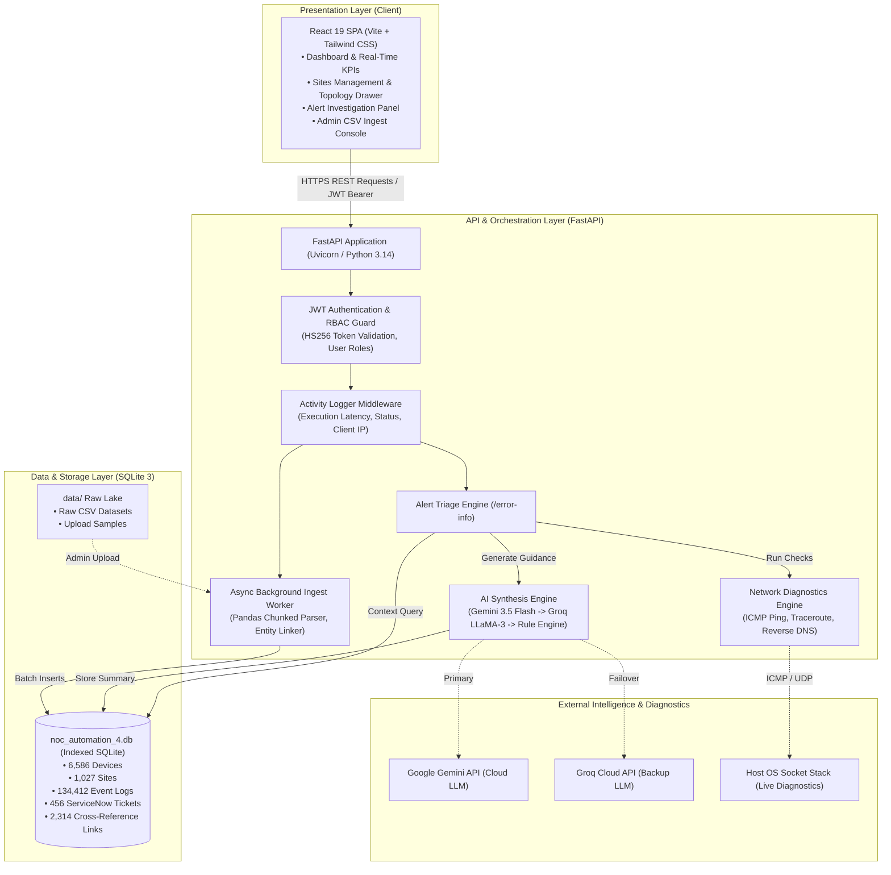
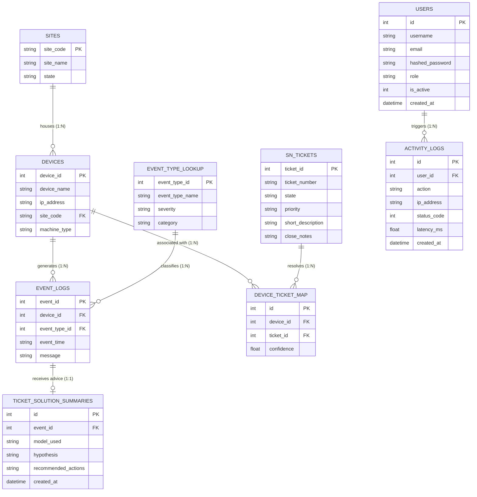
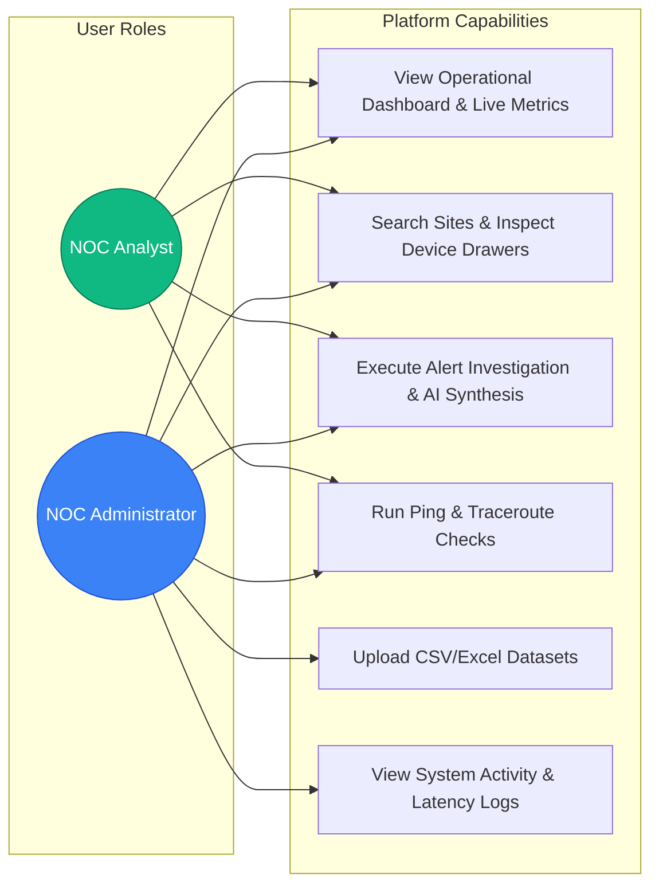

# NOC Automation Platform — Technical Diagrams & Systems Architecture

This document contains the complete, authoritative architectural and workflow diagrams for the Network Alerts Automation Platform (NAAP). All diagrams use standardized Mermaid notation and precisely match the operational codebase.

---

## 1. System Context & Layered Architecture
This diagram outlines how clients, backend micro-services, persistence, and external AI/network subsystems interact.



---

## 2. Sequence Diagram: End-to-End Automated Alert Triage
When an analyst clicks an alert, NAAP automates the entire investigation pipeline in a single request.

```mermaid
sequenceDiagram
    autonumber
    actor Analyst as NOC Analyst
    participant UI as React Console
    participant API as FastAPI (/error-info)
    participant DB as SQLite DB
    participant Diag as Diagnostic Runner
    participant AI as Gemini LLM / Rules

    Analyst->>UI: Selects Alert Card (event_id)
    UI->>API: GET /error-info?event_id=1042
    
    rect rgb(30, 35, 45)
    Note over API,DB: Phase 1: Context Aggregation
    API->>DB: Query Event details, Severity, & Timestamp
    API->>DB: Query Device details (IP, Site Code, Hardware Type)
    API->>DB: Query DEVICE_TICKET_MAP & SN_TICKETS for history
    DB-->>API: Return unified context record
    end

    rect rgb(35, 45, 30)
    Note over API,Diag: Phase 2: Preliminary Diagnostics
    par Diagnostic Execution
        API->>Diag: Execute Ping (Packet loss %, Latency)
        Diag-->>API: Return Ping results
    and Route Verification
        API->>Diag: Execute Traceroute (Hop count, RTT)
        Diag-->>API: Return Hop sequence
    and Name Resolution
        API->>Diag: Reverse DNS Lookup
        Diag-->>API: Return FQDN
    end
    end

    rect rgb(45, 35, 30)
    Note over API,AI: Phase 3: Root Cause Synthesis
    API->>DB: Check TICKET_SOLUTION_SUMMARIES (Cache TTL: 10m)
    alt Cache Hit
        DB-->>API: Return existing synthesis
    else Cache Miss
        API->>AI: Send prompt (Event + Device + Diag + Tickets)
        AI-->>API: Return JSON (Root Cause Hypothesis + SOP Next Steps)
        API->>DB: Store solution in TICKET_SOLUTION_SUMMARIES
    end
    end

    API-->>UI: Return full analysis JSON (Status 200 OK)
    UI-->>Analyst: Render Drawer with context, diagnostics, & action plan
```



---

## 3. Entity-Relationship Diagram (ERD)
The relational schema linking physical sites, managed devices, monitoring alerts, and historical ServiceNow tickets.



---

## 4. Multi-Tier AI Synthesis Hierarchy
Fail-safe logic ensuring analysts always receive recommended remediation steps, even during API downtime or network isolation.

```mermaid
flowchart TD
    Start([Analyst Selects Alert]) --> BuildPrompt[Assemble Unified Context<br/>Device + Event + Diagnostics + Ticket History]
    BuildPrompt --> CheckGemini{Google Gemini<br/>API Available?}

    CheckGemini -- Yes --> CallGemini[Call Gemini 3.5 Flash<br/>Structured JSON Prompt]
    CallGemini -- Success --> SaveCache[Save to TICKET_SOLUTION_SUMMARIES]
    CallGemini -- Rate Limit / Error --> CheckGroq

    CheckGemini -- No / Disabled --> CheckGroq{Groq LLaMA-3<br/>API Available?}
    CheckGroq -- Yes --> CallGroq[Call Groq LLaMA-3<br/>Fast Failover Model]
    CallGroq -- Success --> SaveCache
    CallGroq -- Error --> RuleEngine

    CheckGroq -- No / Disabled --> RuleEngine[Execute Deterministic Rule Engine]
    RuleEngine --> MatchRules{Evaluate Category & Severity<br/>• Interface / BGP / Flap<br/>• Memory / CPU / Temp<br/>• Link Down / Route Loss}
    MatchRules --> GenerateSOP[Synthesize Standard Operating Procedure<br/>(Deterministic Expert Rules)]
    
    SaveCache --> RenderUI([Render Actionable Plan to Analyst])
    GenerateSOP --> RenderUI
```

---

## 5. Asynchronous Data Ingestion Pipeline
Demonstrates how large CSV/Excel files are ingested without blocking the REST API or freezing the UI.

```mermaid
flowchart TD
    Admin([Administrator]) -->|Uploads CSV / Excel| PostAPI[POST /admin/ingest-excel]
    
    subgraph WebAPI ["FastAPI REST Server"]
        PostAPI --> ValidateFile{Validate Headers & Structure}
        ValidateFile -- Invalid Format --> Return400[HTTP 400 Bad Request]
        ValidateFile -- Valid Structure --> CreateJob[Create Record in ingest_jobs<br/>Status = 'queued']
        CreateJob --> SpawnTask[Spawn asyncio Background Worker]
        SpawnTask --> Return202[HTTP 202 Accepted<br/>Returns job_id]
    end

    subgraph FrontendUI ["React Application"]
        Return202 --> PollJob[Poll GET /admin/ingest-excel/{job_id}<br/>Progress Bar & Status Updates]
    end

    subgraph BackgroundWorker ["Async Ingestion Worker"]
        SpawnTask -.-> SetProcessing[Update Status = 'processing']
        SetProcessing --> ChunkRead[Read CSV in 10,000-Row Chunks]
        ChunkRead --> NormalizeData[Normalize Timestamps & Site Codes]
        NormalizeData --> BatchUpsert[Batch UPSERT into SQLite<br/>Devices / Events / Tickets]
        BatchUpsert --> RebuildMap[Recalculate DEVICE_TICKET_MAP<br/>Confidence Scores]
        RebuildMap --> MarkDone[Update Status = 'completed']
    end

    MarkDone --> PollJob
    PollJob --> UIComplete[Display Ingest Summary Banner]
```

---

## 6. Role-Based Access Control (RBAC) & Use Cases


