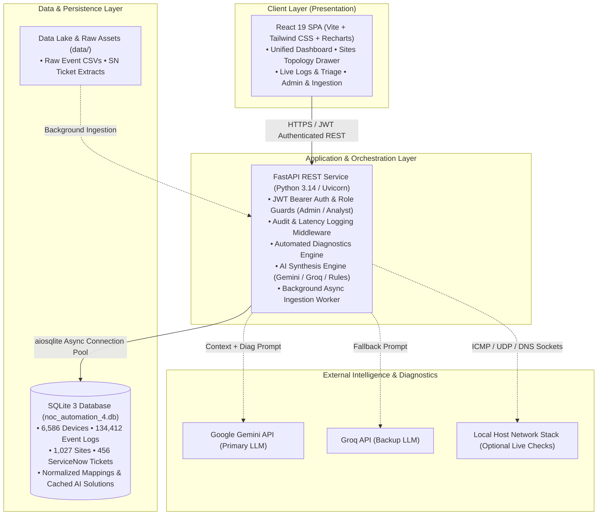
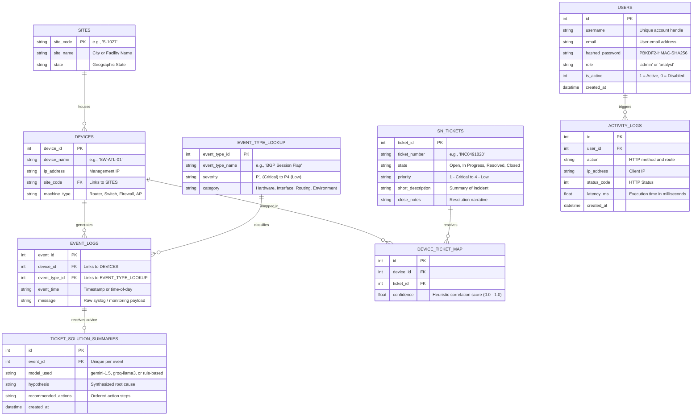
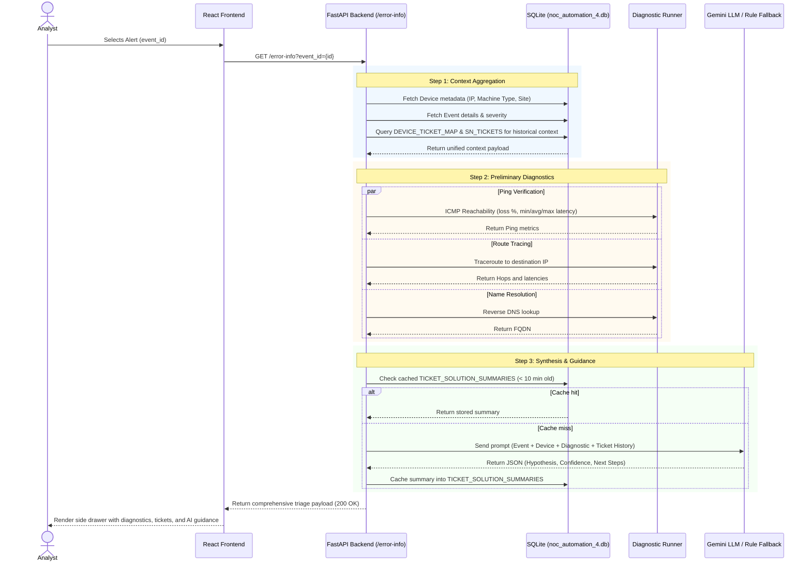
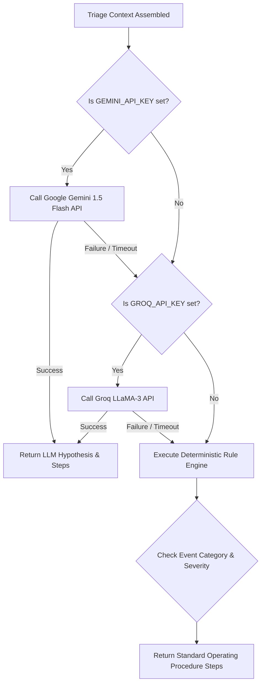

# Network Alerts Automation Platform (NAAP) — Technical Documentation & Architecture Specification

> **Audience:** NOC Leadership, NOC Analysts, Network Engineers, Systems Architects, and Technical Management.  
> **Status:** Operational Pilot & Production Architecture Reference  
> **Last Updated:** October 2026  

---

## 1. Executive Summary & Problem Statement

### The Problem in Enterprise Network Operations
In a modern enterprise Network Operations Center (NOC), Tier-1 and Tier-2 engineers face high alert volumes ("alert storms") across thousands of distributed network devices (core switches, edge routers, distribution points, and wireless controllers).

Key operational pain points include:
1. **Context Fragmentation:** An alert in monitoring tools (SolarWinds, Nagios, Zabbix) does not tell the analyst whether this device flapped yesterday, what the historical ticket notes in ServiceNow were, or what the topology looks like.
2. **Repetitive Triage:** Analysts perform identical manual triage steps: host ping checks, traceroutes, DNS lookups, and searching ticket history across separate systems.
3. **Escalation Overhead:** Incidents are frequently misrouted to specialized engineering teams without proper preliminary triage context.

### The NAAP Solution
The **Network Alerts Automation Platform (NAAP)** unifies alert investigation into an automated, single-pane triage workflow:
- Correlates incoming alerts directly with **ServiceNow incident ticket history** and physical **Site locations**.
- Automatically runs preliminary **reachability and routing diagnostics** (`ping`, `traceroute`, `nslookup`).
- Delivers **AI-synthesized root-cause hypotheses** (via Google Gemini with Groq and deterministic rule fallbacks).
- Organizes the entire infrastructure across **1,027 sites** and **6,586 managed devices** with interactive site drill-down drawers.

```
                    ┌────────────────────────┐
                    │ Network Alert Arrives  │
                    └───────────┬────────────┘
                                │
                                ▼
         ┌──────────────────────────────────────────────┐
         │         Unified Automated Triage Flow        │
         ├──────────────────────┬───────────────────────┤
         │  1. Device Context   │  6,586 Managed Nodes  │
         │  2. Site Topology    │  1,027 Sites & States │
         │  3. Historical Links │  ServiceNow Tickets   │
         │  4. Fast Diagnostic  │  Ping, Trace, DNS     │
         │  5. AI Hypothesis    │  Gemini / Rule Engine │
         └──────────────────────┴───────────────────────┘
                                │
                                ▼
                    ┌────────────────────────┐
                    │ Fast Informed Decision │
                    │ (Mitigate / Escalate)  │
                    └────────────────────────┘
```

---

## 2. High-Level Architecture

The platform follows a decoupled, security-first three-tier architecture:



### Architectural Tenets
1. **No Direct Database Access:** The client interface never accesses persistence layers directly; every interaction is mediated by authenticated, validated FastAPI endpoints.
2. **Defensive Fault Isolation:** The failure of external APIs (such as Gemini or Groq) never crashes or stalls the user experience; deterministic, rule-based fallback engines guarantee uptime.
3. **Auditability:** Every mutation, diagnostic run, login, and data ingestion is logged to an immutable `activity_logs` table.

---

## 3. Database Schema & Data Models

The system is powered by SQLite (`noc_automation_4.db`), optimized with indexes for sub-millisecond query response across 134,000+ records.



### Key Dataset Statistics (Baseline Database)
| Entity | Record Count | Description |
|---|---:|---|
| **Sites** | 1,027 | Normalized facility locations, states, and coordinates |
| **Devices** | 6,586 | Managed network devices across all enterprise facilities |
| **Event Logs** | 134,412 | Historical and simulated monitoring alerts and telemetry |
| **Event Types** | 91 | Unique catalog of network event categories and severities |
| **ServiceNow Tickets** | 456 | Historical enterprise tickets with root-cause resolutions |
| **Device-Ticket Links** | 2,314 | Multi-attribute heuristic cross-references |

---

## 4. Core Subsystems & Operational Workflows

### 4.1. Automated Alert Triage & Root Cause Investigation (`/error-info`)
When an analyst opens an alert from the live stream or dashboard, NAAP triggers a coordinated investigation sequence:



### 4.2. Sites Management & Topology Drill-Down
The Sites page provides multi-dimensional visibility across the enterprise's 1,027 sites:
- **Search & Filter:** Instant filtering by site code, city name, and state.
- **Topology Drawer:** Clicking any site opens a wide detail drawer displaying:
  - Total device inventory for the facility.
  - Interactive table of managed devices (IP address, device type, recent alert counts).
  - Truncation with full-name hover tooltips and in-table search for large sites.
  - Direct links from site devices to corresponding active alerts and historical tickets.

### 4.3. Multi-Engine AI Synthesis Strategy
To ensure enterprise reliability, NAAP implements a three-tier fallback hierarchy for root-cause synthesis:



- **Primary:** Google Gemini 1.5 Flash provides high-speed structured JSON analysis.
- **Secondary:** Groq LLaMA-3 provides sub-second failover.
- **Deterministic SOP Engine:** Pre-compiled Standard Operating Procedures (SOPs) based on alert category (e.g., interface flaps, BGP resets, high CPU utilization) trigger if external cloud access is restricted or offline.

### 4.4. Asynchronous Data Ingestion Engine
When an administrator uploads fresh CSV or Excel exports (`/admin/ingest-excel`):
1. **Fast Response (HTTP 202 Accepted):** File structure is validated and an asynchronous `asyncio` background task is spawned immediately.
2. **Chunked Parsing & Normalization:** The ingest worker parses records in batches, normalizing site codes and timestamp formats.
3. **Cross-Reference Bridge:** New devices are automatically mapped to existing tickets using string similarity and site correlation algorithms.
4. **Client Polling:** The frontend polls `/admin/ingest-excel/{job_id}` with a progress bar, preventing browser timeouts during multi-megabyte uploads.

---

## 5. Security & Authentication Model

- **Authentication Scheme:** JSON Web Tokens (JWT) using HMAC-SHA256 (`HS256`).
- **Token Lifespan:** Access tokens expire after 60 minutes; refresh tokens expire after 7 days.
- **Password Storage:** Industry-standard PBKDF2-HMAC-SHA256 with 390,000 iterations (OWASP recommendation).
- **Role-Based Access Control (RBAC):**
  - `analyst`: Dashboard, Sites, Alerts console, Error-Info triage, diagnostics execution, solution summary view.
  - `admin`: All analyst permissions plus CSV ingestion, background job management, and system activity logs.
- **Token Invalidation:** Explicit logout adds the token's unique identifier (`jti`) to the `token_blocklist` table.

---

## 6. Repository Layout

The project structure is organized cleanly by responsibility:

```
noc-ps/
├── backend/                   # FastAPI application & test suite
│   ├── database/              # SQLite connection wrapper, migrations, and schema
│   ├── routers/               # Endpoint controllers (auth, metrics, sites, logs, etc.)
│   ├── services/              # Business logic (metrics_service, auth_service, etc.)
│   ├── utils/                 # Security (JWT, hashing), diagnostics, and exception handlers
│   ├── tests/                 # Automated Pytest suite (101 unit & integration tests)
│   └── requirements.txt       # Python dependencies
├── frontend/                  # React 19 SPA (Vite + Tailwind CSS + Lucide + Recharts)
│   ├── src/pages/             # UI views (Dashboard, Sites, Alerts, Tickets, Logs, Login)
│   ├── src/services/          # API client and local demo fallback handlers
│   └── package.json           # Frontend dependencies
├── data/                      # Data assets
│   ├── raw/                   # Source anonymized datasets (Events, Tickets)
│   ├── samples/               # Sample CSVs for upload testing
│   └── legacy_dbs/            # Inactive database snapshots
├── docs/                      # Technical documentation, diagrams, and schemas
├── scripts/                   # Benchmarks, query tests, and incremental updater
├── sql/                       # SQL migrations, sites seed dump, and query templates
├── noc_database_setup 1/      # Standalone initial ETL pipeline module
├── noc_automation_4.db        # Active database file (6,586 devices, 134,412 events)
├── start.sh / start.bat / start.ps1   # Multi-platform unified launch scripts
├── stop.sh / stop.bat                 # Multi-platform shutdown scripts
└── README.md                  # Quickstart documentation
```

---

## 7. Operations, Verification & Maintenance

### 7.1. Quick Launch
```bash
# Linux / macOS
./start.sh

# Windows (Command Prompt)
start.bat

# Windows (PowerShell)
.\start.ps1
```

### 7.2. Test Suite Execution
The backend includes a comprehensive 101-test suite covering authentication, RBAC, query logic, metrics calculation, and database migrations:
```bash
cd backend
PYTHONPATH=. .venv/bin/pytest tests/
```
**Verification Target:** `101 passed` with 0 failures.

### 7.3. Frontend Build Validation
```bash
cd frontend
npm run build
```
**Verification Target:** Clean compilation into `frontend/dist/`.
