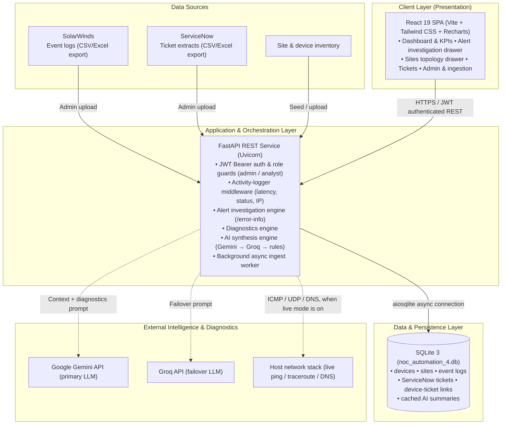
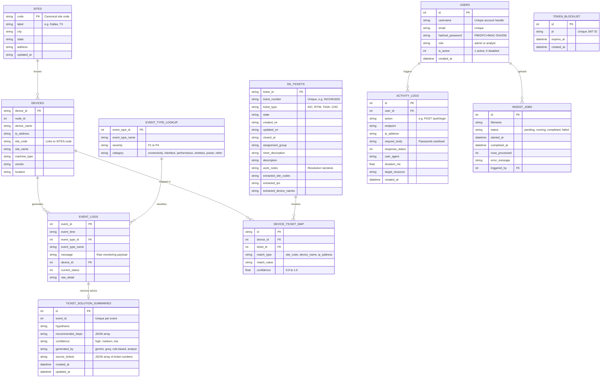
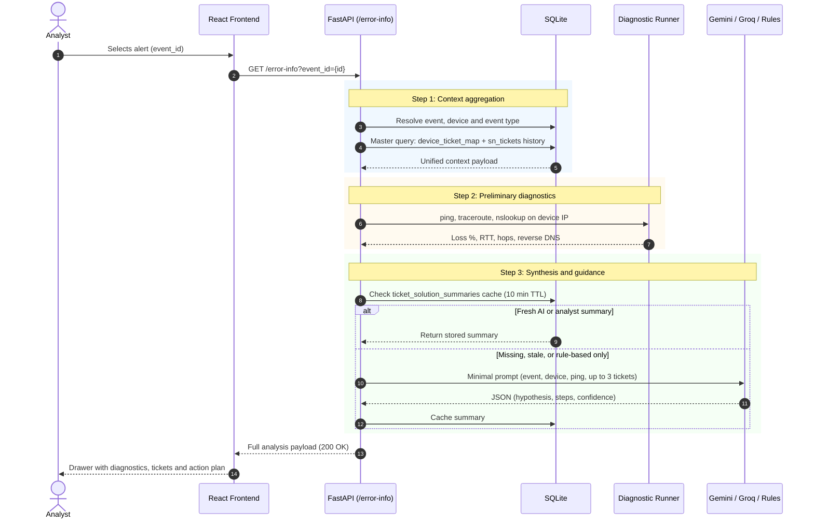
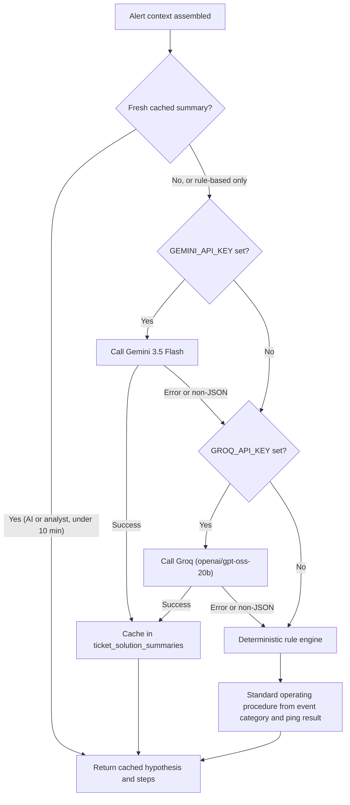

# Nocturne — Technical Documentation & Architecture Specification

> **Nocturne** (formerly NAAP, the Network Alerts Automation Platform) is a NOC alert-investigation platform that connects **SolarWinds** monitoring events, **ServiceNow** ticket history and live diagnostics into one AI-guided investigation screen.
>
> **Audience:** NOC Leadership, NOC Analysts, Network Engineers, Systems Architects, and Technical Management.  
> **Status:** Demo build reference. Section 8 lists what is real today and what is planned.  
> **Last Updated:** October 2026

---

## 1. Executive Summary & Problem Statement

### The Problem in Enterprise Network Operations
In a modern enterprise Network Operations Center (NOC), Tier-1 and Tier-2 engineers face high alert volumes across thousands of distributed network devices (core switches, edge routers, distribution points, and wireless controllers).

Key operational pain points:
1. **Context Fragmentation:** An alert in SolarWinds does not tell the analyst whether the device flapped yesterday, what the ServiceNow work notes said last time, or where the device sits in the site topology.
2. **Repetitive Manual Checks:** Analysts repeat the same manual steps: host ping checks, traceroutes, DNS lookups, and searching ticket history across separate systems. The team's working estimate is 8–15 minutes per incident.
3. **Escalation Overhead:** Incidents are escalated to specialist engineers without preliminary diagnostics or ticket history.

### The Nocturne Solution
Nocturne sits **between** SolarWinds and ServiceNow. It replaces neither: SolarWinds stays the monitor of record and ServiceNow stays the system of record.

- Correlates alerts with **ServiceNow incident history** and physical **site** data.
- Runs preliminary **reachability and routing diagnostics** (`ping`, `traceroute`, `nslookup`).
- Delivers **AI-synthesised root-cause hypotheses and ordered SOP steps** (Google Gemini, then Groq, then a deterministic rule engine).
- Organises **sites and their managed devices** with interactive site drill-down drawers.
- Keeps the human in control: AI output is advisory only.

```
                    ┌────────────────────────┐
                    │ SolarWinds Alert Event │
                    └───────────┬────────────┘
                                │
                                ▼
         ┌──────────────────────────────────────────────┐
         │  Nocturne Unified Investigation (one click)  │
         ├──────────────────────┬───────────────────────┤
         │  1. Device Context   │  Managed devices      │
         │  2. Site Topology    │  Sites & states       │
         │  3. Historical Links │  ServiceNow Tickets   │
         │  4. Live Diagnostics │  Ping, Trace, DNS     │
         │  5. AI Hypothesis    │  Gemini / Groq / Rules│
         └──────────────────────┴───────────────────────┘
                                │
                                ▼
                    ┌────────────────────────┐
                    │ Fast Informed Decision │
                    │ (Mitigate / Escalate)  │
                    └────────────────────────┘
```

---

## 2. High-Level Architecture

Nocturne follows a decoupled, three-tier architecture with a hard boundary between the browser and the data.



### Architectural Tenets
1. **No Direct Database Access:** The client never touches the database; every interaction passes through authenticated, validated FastAPI endpoints.
2. **Defensive Fault Isolation:** Failure of Gemini or Groq never stalls the analyst. A deterministic rule engine always returns an answer.
3. **Advisory AI:** Nocturne suggests; the analyst decides. No automatic configuration changes.
4. **Auditability:** Authenticated requests, logins and ingest actions are recorded in `activity_logs` with latency and status.
5. **Minimal AI context:** The LLM prompt contains only the device (name, IP, type), the event, a ping summary, the recent incident count and up to three past tickets (number, state, short description), plus a cached summary if one exists. Raw logs, full ticket descriptions and work notes are not sent; work notes are shown to the analyst in the UI.

---

## 3. Database Schema & Data Models

The system uses SQLite (`noc_automation_4.db`) with indexes on device, event, ticket and site lookups.



> **Note:** `devices.device_id` is declared `TEXT` in the baseline schema while `event_logs.device_id` is `INTEGER`; SQLite type affinity makes the join work. The relationship between `devices.site_code` and `sites.code` is by convention (no enforced foreign key).

---

## 4. Core Subsystems & Operational Workflows

### 4.1. Automated Alert Investigation & Root-Cause Analysis (`GET /error-info?event_id=`)
When an analyst opens an alert, Nocturne runs the whole investigation in one request:



Notes:
- A cached **rule-based** summary is treated as a fallback only: when an AI provider is configured, the service retries the providers and upgrades the cache.
- If a device has no historical tickets, the AI analyses the event type and diagnostics only, and the response is flagged as having no ticket context.
- **Diagnostics mode:** with `FAKE_DIAGNOSTICS=True` (the default) `ping`, `traceroute` and `nslookup` return deterministic simulated results, which suits demos. Set `FAKE_DIAGNOSTICS=False` to run real system commands.

### 4.2. Sites Management & Topology Drill-Down
The Sites page gives visibility across every site:
- **Search & Filter:** Text search by site code, label or city, plus state filter, paginated (`/sites`, `/sites/{code}`).
- **Topology Drawer:** Clicking a site opens a wide drawer with:
  - Total device inventory for the facility.
  - A filterable table of devices (IP, type, recent alert counts).
  - Truncation with full-name hover tooltips for large sites.
  - Direct links from a device to its alerts and historical tickets.

### 4.3. Multi-Engine AI Synthesis Strategy
Nocturne uses a three-tier fallback so analysts always get guidance:



- **Primary:** Google Gemini 3.5 Flash returns structured JSON (hypothesis, ordered steps, confidence).
- **Secondary:** Groq (`openai/gpt-oss-20b` in the current code) takes over on error or rate limit, returning the same JSON shape.
- **Deterministic rule engine:** built-in SOP rules by event category and ping result; needs no external service and always succeeds.
- **Cost control:** summaries are cached per event for `SOLUTION_SUMMARY_CACHE_TTL_MINUTES` (default 10).
- **Replaceable provider layer:** Gemini and Groq are the providers used in the current demo build. Provider calls are isolated in `services/llm_service.py` behind a single entry point (`generate_suggested_solution`), so they can be replaced with an enterprise AI service without changing the rest of the pipeline. The rule engine remains as the final fallback.

### 4.4. Asynchronous Data Ingestion Engine
This is how SolarWinds event exports and ServiceNow ticket exports enter Nocturne today. An administrator uploads a CSV or Excel file (`POST /admin/ingest-excel`):
1. **Fast response (HTTP 202 Accepted):** the file is size-checked (`MAX_INGEST_FILE_SIZE_MB`, default 100), its type is auto-detected from headers (event log or ticket), an `ingest_jobs` record is created and an `asyncio` background task starts.
2. **Parse and normalise:** the worker reads the file with pandas, normalises site codes and timestamps and upserts devices, events and tickets.
3. **Cross-reference bridge:** devices are linked to tickets by site code, device name and IP address, each link stored with a `match_type` and a `confidence` score in `device_ticket_map`.
4. **Client polling:** the UI polls `GET /admin/ingest-excel/{job_id}` until the job is `completed` or `failed`.

> The worker is in-process and not durable: an API restart can interrupt an active import.

---

## 5. Security & Authentication Model

- **Authentication:** JSON Web Tokens (JWT) signed with HMAC-SHA256 (`HS256`).
- **Token lifespan:** access tokens expire after **30 minutes** (`ACCESS_TOKEN_EXPIRE_MINUTES`); refresh tokens after **7 days** (`REFRESH_TOKEN_EXPIRE_DAYS`).
- **Password storage:** PBKDF2-HMAC-SHA256, 390,000 iterations, per-user random salt (Python standard library).
- **Role-based access control:**
  - `analyst`: dashboard, sites, alerts, tickets, `/error-info` alert investigation and solution summaries.
  - `admin`: everything an analyst can do, plus CSV/Excel ingestion, ingest-job management and the activity log.
- **Token invalidation:** logout stores the token's `jti` in `token_blocklist`, and blocklisted tokens are rejected.
- **Audit trail:** the activity-logger middleware records user, action, endpoint, client IP, status, latency and a sanitised request body.

### Hardening checklist before production use
- [ ] Replace the default admin account (`admin` / `admin123`, created on first start).
- [ ] Set a long random `SECRET_KEY` (the default is a placeholder).
- [ ] Restrict `CORS_ORIGINS` (default is `["*"]`).
- [ ] Set `FAKE_DIAGNOSTICS=False` on a server with network reach to the devices.
- [ ] Decide which AI providers are approved (currently Gemini and Groq), and set only those API keys.

---

## 6. Repository Layout

```
noc-ps/
├── backend/                   # FastAPI application & test suite
│   ├── database/              # SQLite connection wrapper and migrations
│   ├── routers/               # Endpoints: auth, metrics, sites, tickets, logs, admin, error_info, solution_summaries, simulation
│   ├── services/              # Business logic: alert investigation, diagnostics, LLM, tickets, ingest, auth, metrics
│   ├── workers/               # Async ingest worker
│   ├── middleware/            # Activity logger and dev logger
│   ├── utils/                 # Security (JWT, hashing), pagination, exceptions
│   ├── tests/                 # Pytest suite (101 tests)
│   └── requirements.txt       # Python dependencies
├── frontend/                  # React 19 SPA (Vite + Tailwind CSS + Lucide + Recharts)
│   ├── src/pages/             # Dashboard, Alerts, AlertEventDetails, Sites, Tickets, Admin, Login
│   ├── src/components/        # AlertDrawer, RelatedTickets, Pagination, ...
│   ├── src/services/          # API client and demo fallback
│   └── package.json
├── data/                      # raw/ (anonymised exports), samples/, legacy_dbs/
├── docs/                      # This document, diagrams and schema notes
├── scripts/                   # Benchmarks, query tests, incremental updater
├── sql/                       # Migrations, site seed, query templates
├── noc_database_setup 1/      # Standalone initial ETL pipeline
├── noc_automation_4.db        # Active database
├── start.sh / start.bat / start.ps1
└── README.md
```

---

## 7. Operations, Verification & Maintenance

### 7.1. Quick Launch
```bash
./start.sh        # Linux / macOS
start.bat         # Windows (Command Prompt)
.\start.ps1       # Windows (PowerShell)
```
Frontend: http://localhost:5173  ·  API docs: http://localhost:8000/docs

### 7.2. Configuration reference (`backend/.env`)
| Variable | Purpose | Default |
|---|---|---|
| `GEMINI_API_KEY` | Enables Gemini (primary LLM) | empty |
| `GROQ_API_KEY` | Enables Groq (failover LLM) | empty |
| `SOLUTION_SUMMARY_CACHE_TTL_MINUTES` | AI summary freshness | `10` |
| `FAKE_DIAGNOSTICS` | Simulate ping/traceroute/nslookup | `True` |
| `ACCESS_TOKEN_EXPIRE_MINUTES` / `REFRESH_TOKEN_EXPIRE_DAYS` | Token lifetimes | `30` / `7` |
| `SECRET_KEY` | JWT signing key | placeholder, **change it** |
| `CORS_ORIGINS` | Allowed origins | `["*"]` |
| `MAX_INGEST_FILE_SIZE_MB` | Upload limit | `100` |

### 7.3. Test Suite
```bash
cd backend
PYTHONPATH=. .venv/bin/pytest tests/
```
The repository contains 101 test functions. Re-run the suite and confirm `101 passed` before quoting the figure externally.

### 7.4. Frontend Build Validation
```bash
cd frontend && npm run build
```
Target: clean compilation into `frontend/dist/`.

---

## 8. Integrations, Positioning & Roadmap

### 8.1. SolarWinds and ServiceNow: today vs. planned
| | Today | Planned |
|---|---|---|
| **SolarWinds events** | Imported from CSV/Excel exports via the Admin upload | Live syslog / Kafka streaming |
| **ServiceNow tickets** | Imported from CSV/Excel exports; linked to devices by site, name and IP | Bidirectional API sync (enrich tickets with diagnostics) |
| **Diagnostics** | Simulated by default; live mode via `FAKE_DIAGNOSTICS=False` | Pre-approved one-click actions with approval |

### 8.2. Where Nocturne adds value next to SolarWinds AI
Nocturne complements SolarWinds; it does not replace it. SolarWinds' AI works on SolarWinds' own data. Nocturne combines SolarWinds events, ServiceNow resolution history, site inventory and live checks, and ends in an ordered action plan.

Per SolarWinds' public announcements and documentation (AI Agent launched in tech preview in October 2025; self-hosted preview in 2026.1):
- The AI Agent answers natural-language questions about monitored data and is **observational**: it does not change configurations, run scripts or remediate.
- The self-hosted agent requires a cloud connection (Platform Connect).
- Incident correlation and knowledge-base generation were announced for **SolarWinds Service Desk**; ServiceNow-specific support is not documented.
- After general availability some capabilities may require a different licence tier or extra charges.

**Verify current availability before quoting these points,** because the features were still rolling out.

| Capability | SolarWinds AI (as documented) | Nocturne |
|---|---|---|
| Uses our ServiceNow resolution history | Not documented for ServiceNow | Yes: tickets linked to the device feed the prompt (number, state, short description); full work notes are shown to the analyst alongside |
| Ends in an action plan | Observational in preview | Ordered SOP steps per alert |
| Live checks in the same view | Q&A over monitored data | Ping, traceroute and DNS on alert open |
| Works without cloud AI | Cloud connection required (self-hosted agent) | Rule engine needs no cloud |
| Licensing | May change after GA | Internal build; AI usage cost only, cached |

Sources: SolarWinds press release (8 Oct 2025), ChannelE2E (9 Oct 2025), THWACK AI Agent preview post, SolarWinds Observability AI settings documentation.

### 8.3. Roadmap
- **Today (demo build):** single-screen alert investigation, CSV/Excel ingestion, three-tier AI synthesis, local JWT accounts with analyst/admin roles and an audit log.
- **Phase 2 (3–6 months):** live syslog/Kafka, bidirectional ServiceNow sync, durable job queue for heavy ingests.
- **Phase 3 (6–12 months):** pre-approved one-click remediation (for example port bounce), automated carrier tickets, predictive site health.
