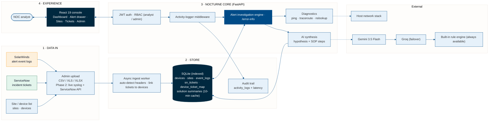

# Nocturne — System Architecture Diagram

High-level architecture of **Nocturne** (formerly NAAP): data in, storage, core services and the analyst experience. Today, SolarWinds and ServiceNow data arrives by CSV/Excel export through the Admin upload; live feeds are on the roadmap.

